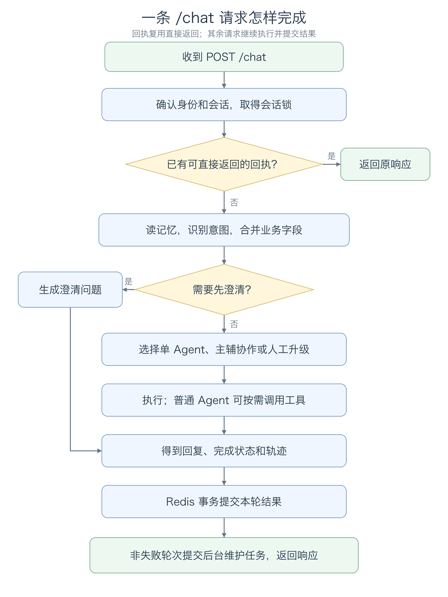

# EduMind 业务流程说明（教育培训场景）

本文按当前 Python 代码说明一条学习咨询怎样处理，以及知识维护、学习画像、监控和评测怎样运行。

流程图使用 PNG 图片，普通 Markdown 预览器即可显示。移动或分享文档时，请保留相邻的 `assets/flows/` 图片目录。

全文用下面这条消息作例子：

> 数学导数这块不会，函数单调性怎么用导数判断？还有 30 天期末，每天两小时，帮我排个复习计划。

它同时包含"讲知识点"和"排计划"两件事，正好用来说明：意图怎样识别、为什么交给 Tutor、什么时候需要 Plan 协作、工具检查出什么、回复怎样保存。遇到"回执""事务""熔断"等术语时，会结合这条流程说明它们的作用。

例子中的意图分数、模型选择和回复是为了讲清代码而设定的条件，不是一次线上调用的实测结果。函数顺序、字段和分支规则以代码为准。

主要入口是 HTTP `POST /chat`。文中涉及的会话锁、请求回执和整轮提交都以这个入口为准，CLI 与评测的区别放在后面。启动与配置方法见 [README](../README.md)，逐步阅读源码可以参考 [教程目录](教程/README.md)。

可以按需要阅读：

- 跟完一条正常消息：[总流程](#flow-overview) → [请求与重试](#request-entry) → [背景、意图和字段](#context-intent) → [角色选择](#routing) → [模型与工具](#agent-tools) → [响应和保存](#response-commit)。
- 看数据后续怎样维护：[后台记忆](#memory-maintenance)、[知识库更新](#knowledge-maintenance)。
- 排查效果或运行问题：[监控与恢复](#monitor-recovery)、[评测与 CLI](#evaluation-cli)、[实际检查步骤](#verification)、[参数速查](#limits)。


<a id="flow-overview"></a>

## 1. 先看一轮对话的顺序

先假设这是一位高二学生在一段新会话里发来的问题。服务取出已有背景，判断这句话主要想解决什么问题，选择讲题老师 Tutor。Tutor 拿到学科、章节后，可以用结构化检索取到教材片段，再组织分层讲解；同时因为学生提了"帮我排个复习计划"，Plan 作为辅助角色并行给出阶段安排。

Agent 在这里指一个有特定职责、提示词和工具集合的处理角色。Tutor 负责讲知识点和辅导作业，Plan 负责排学习计划，Exam 负责考试事务，General 负责平台使用和首轮接待。它们在同一个 Python 应用中运行，编排器负责决定这一轮由谁处理。

正常走完一轮后，回复和会话记录一起保存。学生下一次追问时，后端就能继续使用这次收集到的学科、章节和时长。



[查看这张图的可编辑源文件](assets/flows/chat-flow-current.mmd)

事务同时保存回执和可用轨迹，非失败轮次还保存消息与学习槽位。图中的回执检查会处理消息冲突和可重试失败，具体规则见下一节。未捕获异常、超时或失锁可能提前中断流程，不一定执行到提交步骤。

RAG 在 Agent 执行期间通过工具触发。主流程没有按意图预先检索知识库，也不会每轮聊天都自动运行评测。

### 服务启动时，先准备好哪些东西

`api/main.py` 的 `lifespan()` 在接收聊天之前初始化各模块。可以把这个阶段理解为先准备老师的角色、教材、工具和记录方式。

| 启动时创建的对象 | 负责的事情 | 与一轮聊天的关系 |
| --- | --- | --- |
| `SkillManager` | 从文件读取教学规范 | Agent 构造提示词时挑选匹配的规则 |
| `AgentOrchestrator` | 创建角色、识别器和回复汇总器 | 识别诉求、路由、执行和合并回复 |
| `MemoryManager` | 准备 Redis、历史摘要和学习画像存储 | 读旧信息，保存新对话 |
| `KnowledgeBase`、`MCPToolManager` | 准备教材知识库和工具管理 | 模型选择工具后，由程序执行 |
| `StandardMCPClient` | 连接配置中的外部工具服务 | 把获准的外部工具提供给相应角色 |
| `PerformanceMonitor` | 启动周期采样 | 发现 Agent 和工具的运行问题 |
| 评测对象、后台维护 worker | 准备评测和记忆维护 | 按需评测，异步压缩和更新画像 |

这些对象会被多轮请求复用，不是每发一句话都重新创建。工具调用记录等属于单次请求的数据另行保存，避免两个学生同时聊天时互相串数据。

`/health` 只检查应用是否已完成相关初始化，不会每次实际请求模型、Redis 和知识库。因此，健康接口正常之后，还应通过一次聊天确认模型配置可用。

### 这条消息会经过哪些函数

下面是主流程中几个重要的接力点。表里的"交出去"表示函数返回值或组装出的对象。

| 顺序 | 当前函数 | 接到什么 | 做完后交出去什么 |
| --- | --- | --- | --- |
| 1 | `chat()` | `ChatRequest`，即 HTTP 请求中的字段 | 当前学生、会话和客户端请求 ID |
| 2 | `get_turn_receipt()` | 学生、会话、客户端 ID | 已有回执，或没有回执 |
| 3 | `get_context()` | 学生、会话、当前消息 | `MemoryContext`，包含历史、摘要、画像和学习状态 |
| 4 | `recognize_intent()` | 当前消息和最近历史 | `IntentResult`，包含意图、分数、紧急度和实体 |
| 5 | `run()`、`merge_state()` | 组装好的内部 `Request` | 合并后的槽位，以及本轮执行结果 |
| 6 | `_route_decision()`、`_execute()` | 诉求、实体与运行状态 | 角色选择、Agent 回复和工具明细 |
| 7 | `commit_turn()` | 学生消息、响应、学习状态、轨迹 | Redis 中一整轮记录和响应回执 |
| 8 | `ProfileUpdater.submit()` | 学生和会话 | 待后台处理的记忆维护任务 |

API 已经识别过意图时，会把结果填进内部 `Request`。`run()` 看到 `intent` 已有值，就不会再识别一次。CLI 和对话评测可以直接交给 `run()`，由它补做识别。

代码：[api/main.py](../api/main.py) 的 `lifespan()`、`chat()`；[agent_orchestrator.py](../agents/agent_orchestrator.py) 的 `run()`。

<a id="request-entry"></a>

## 2. 请求进入后，先确认"谁、哪段会话、哪条消息"

客户端可以这样提交一条消息：

```json
{
  "message": "数学导数这块不会，函数单调性怎么用导数判断？还有30天期末，每天两小时，帮我排个复习计划。",
  "user_id": "student_01",
  "conv_id": "demo-derivative",
  "client_request_id": "msg-001"
}
```

`message` 长度为 1～12000 字符。`user_id` 默认是 `anonymous`；开启 Token 鉴权后，以 Token 对应用户为准，请求体中的 `user_id` 会被覆盖。开启后，缺少有效身份返回 `401`，普通用户访问管理接口返回 `403`。`production` 模式要求配置有效的访问 Token。

有三个编号需要分清：

| 字段 | 谁提供 | 用来做什么 |
| --- | --- | --- |
| `conv_id` | 客户端提供，或服务端生成 | 标识会话；后续追问沿用同一个值 |
| `client_request_id` | 客户端提供，缺省时服务端生成 | 标识一条逻辑消息；重试保留，新消息更换 |
| `request_id` | 编排请求创建时生成 | 标识一次执行，可查询工具轨迹 |

未传 `conv_id` 时，服务根据学生和客户端请求 ID 生成确定性的 UUID；未传客户端 ID 时先生成随机 ID。因此，调用方要可靠重试，应主动传入 `client_request_id`，并在后续对话中保存返回的 `conv_id`。

例如，本文第一轮使用 `demo-derivative / msg-001`：

| 学生接下来的动作 | `conv_id` | `client_request_id` |
| --- | --- | --- |
| 网络断了，重发原来的导数问题 | 仍是 `demo-derivative` | 仍是 `msg-001` |
| 继续问"那单调区间怎么求" | 仍是 `demo-derivative` | 改为 `msg-002` |
| 开始一段独立的新对话 | 换一个会话 ID | 使用新的消息 ID |

服务端 `request_id` 在下文用 `R1`、`R2` 简写，实际通常是 UUID。拿 `R1` 查的是某次执行过程；拿 `msg-001` 重试的是同一条学生消息，二者不能互换。

### 同一会话的消息怎样排队

从读上下文到提交结果，整轮请求都持有会话锁。同一进程按会话排队，跨进程使用可续租的 Redis 锁；不同会话可以同时处理。Redis 锁等待超时或租约失效会中止请求，返回 `503`。

为什么需要这把锁？假设学生很快连续发送两条消息：

1. 如果两条同时读上下文，可能都读到同一份旧状态，后写入的会覆盖前一条的槽位。
2. 如果先读后写不互斥，第二句可能在第一句还没提交时就读不到它补的章节，只能重复追问。

锁的粒度是"学生 + 会话"，不同学生互不影响。锁不是把整个服务串行化，生产环境更要注意不要在锁内做耗时操作。

### 怎样判断是不是重试

`client_request_id` 的作用是幂等。提交成功后，回执放在 Redis 24 小时；同一个 ID 再次出现时：

- 消息相同且上次成功或部分成功：直接返回上次的响应，不再调用模型。
- 消息相同但上次是可重试失败：重新执行。
- 消息不同：返回 `409`，避免同一个 ID 指向两条不同的问题。

这条规则解决的是"学生点了两次发送"和"网络超时后客户端自动重试"两类情况。可能修改数据的工具执行前会先写一条不可重放的失败回执，防止重试时重复执行。

<a id="context-intent"></a>

## 3. 读取背景，判断诉求，再合并本轮字段

### 会话里读出哪些信息

`MemoryManager.get_context()` 依次读取近期消息、相关历史摘要、学习画像、当前会话摘要和会话状态。

近期消息从 Redis 最多读取 20 条，恢复成时间顺序。情景记忆先查同学生、同会话；不足时再扩展到该学生的其他会话，去重后最多保留 5 条。学习画像按学生保存，同一学生的不同会话可以复用。

不同信息有不同用途：意图识别收到最近 5 条消息作为历史，其内部 LLM 提示和缓存键实际取最后 3 条；Agent 的背景文本包含会话摘要、最多 3 条相关历史、学习画像和最近 8 条消息。学习槽位另行合并，不依赖模型每轮从长对话里重新寻找。

情景记忆检索失败时返回空历史，画像读取失败时使用空画像；Redis 等其他异常仍可能中断请求。

为便于阅读，可以先把这些记忆理解成四类记录：

| 记录 | 内容举例 | 在这一轮做什么 |
| --- | --- | --- |
| 最近聊天 | 学生上轮说过"我是高二" | 让模型接住追问 |
| 会话摘要与相关历史 | 之前讲过哪几章、卡在哪一步 | 消息较多或跨会话时补充背景 |
| 学习画像 | 年级、学科、薄弱章节、目标、可投入时间 | 调整讲解深度和计划重点 |
| 当前学习状态 | 学科、章节、考试名称、时长及来源 | 明确当前任务可以继承哪些槽位 |

新学生、新会话的这些记录通常为空，`get_context()` 仍会返回一个 `MemoryContext`，只是对应字段为空。教材知识库属于另一套资料，不会因为学生没有历史就没有内容可查。

API 随后把数据组装进内部 `Request`：`context` 是整理好的背景文本，`history` 给意图识别使用，`entities` 起初是本轮提取的字段，`conversation_state` 是之前保存的任务状态。后面的函数都围绕这个请求继续处理。

### 三路意图结果怎样合并

LLM 根据消息和历史判断语义，Embedding 比较问题与意图模板的相似度，Pattern 根据关键词提供候选。LLM 与向量分支并行，Pattern 在本地执行。

默认权重为 `LLM 0.7 / Embedding 0.2 / Pattern 0.1`。正常融合先汇总业务组得分，再选获胜组里的具体意图。教育场景的组映射是：`knowledge_query`、`homework_help`、`course_recommend` 都算入 `query` 组，`study_plan` 算入 `request` 组，`human_handoff` 算入 `escalation` 组。

选出组内意图后还有两种处理：

1. 如果选到粗意图，而 Pattern 给出同组细意图，且 Pattern 分数至少为 `0.5`、组分数小于 `0.8`，使用细意图，置信度取两者较大值。
2. 不满足细化条件时，组分数低于默认阈值 `0.5` 就返回 `other`，否则返回组内获胜意图。

LLM 失败走单独的回退分支：优先使用非 `other` 且有正分的 Embedding 结果，再用 Pattern，均不可用才返回 `other`。这条分支不经过正常加权和阈值判断。`intent_source_scores` 保存各来源的原始分数；发生细化时还会记录 `refined_by_pattern`。

这条细化规则在教育场景特别有用：学生说"这个不会"时，LLM 很容易只给出宽泛的 `query`，而 Pattern 命中"这题""不会做"后能把它纠正为 `homework_help`，从而路由到讲题而不是通用接待。

向量分支可配置硅基流动 `BAAI/bge-m3`。缺少 Key、在线失败或处于冷却期时，问题与模板一起使用本地 256 维字符 n-gram 哈希向量。`intent_embedding_source` 表示本次实际来源；它不改变知识库的向量模型。识别结果还会缓存在进程内，缓存键包含完整消息和最近历史。

### 把三路融合算一遍

仍用本文问题说明。假设这一次三路返回下面的结果，分数只为演示计算：

| 来源 | 认为是什么问题 | 原始分数 | 权重 | 加权分数 |
| --- | --- | --- | --- | --- |
| LLM | `knowledge_query`，知识点提问 | `0.80` | `0.7` | `0.56` |
| Embedding | `homework_help`，作业辅导 | `0.70` | `0.2` | `0.14` |
| Pattern | `knowledge_query` | `0.60` | `0.1` | `0.06` |

三个结果都属于 `query` 组，因此该组分数是 `0.56 + 0.14 + 0.06 = 0.76`。组内 `knowledge_query` 得分 `0.62`，高于 `homework_help` 的 `0.14`，最终使用 `knowledge_query`，置信度为 `0.76`。

这样，后续既知道它属于"知识类"诉求，也知道具体是知识点提问而不是作业辅导。若组分数很低、又没有满足细化条件，就可能得到 `other`，交给澄清逻辑处理。

这次识别可简化看成下面的记录，省略了说明和耗时等字段：

```json
{
  "intent": "knowledge_query",
  "intent_group": "query",
  "confidence": 0.76,
  "source_scores": {
    "llm": 0.8,
    "embedding": 0.7,
    "pattern": 0.6
  }
}
```

分数是这一套融合规则的计算结果，不表示已经统计证明有 76% 的业务正确率。规则中的权重、细化条件和阈值也属于不同判断步骤，不能只看一个分数就跳过其他分支。

### 实体与紧急度从哪里来

实体通过规则从当前消息提取，教育场景的字段是学科、年级、章节、考试名称、难度、学习周期、每日时长和日期。

紧急度也使用规则。代码先清除部分"不紧急""not urgent"等否定表达，再判断关键词。"紧急""立刻"等可触发 `CRITICAL`，"今天""尽快""截止"等为 `HIGH`；无关键词时，转人工意图默认 `HIGH`，投诉默认 `MEDIUM`，其余为 `LOW`。`HIGH` 本身不强制转人工，`CRITICAL` 会进入升级路由。

本文消息中的实体会提取为：

```json
{
  "subject": ["数学"],
  "grade": [],
  "chapter": ["导数", "函数"],
  "exam_name": ["期末"],
  "difficulty": [],
  "duration": ["30天"],
  "study_time": ["每天两小时"],
  "date": []
}
```

这里 `chapter` 可能同时包含"导数"和"函数"两个词，因为它们在有限章节词表里同时出现；章节词表是收敛的枚举，不做自由文本抽取，否则无法用于元数据过滤。`subject` 同理只允许课表内的学科名。日期和时长的原表达会保留，代码没有在这一步把它们换算成标准日期。

主例子没有紧急关键词，假设最终意图为 `knowledge_query`，紧急度为 `LOW`。如果消息说"明天就考试了，尽快帮我看看"，`HIGH` 仍可由 Tutor 处理；触发 `CRITICAL` 的请求才会在后续路由中优先进入升级。

### 上轮的学科和章节什么时候还能使用

编排器在路由前调用 `merge_state()`，把本轮实体与 Redis 读出的状态合并。状态包含 `domain`、`entities` 和字段来源 `sources`，来源记录对应的服务端请求 ID。

槽位分三类生命周期：

| 类型 | 字段 | 规则 |
| --- | --- | --- |
| 学生身份 | `grade`、`subject`、`exam_name` | 跨学科、跨任务保留，换话题也不丢 |
| 学科局部 | `chapter`、`difficulty` | 同一学科内继承；**换学科立即清空**，避免把数学的薄弱章节带到物理 |
| 任务局部 | `duration`、`study_time`、`date` | 只在同一任务域内继承；明确"换一个问题/另一门课"时清空 |

第一轮合并完成后，状态可以简化为：

```json
{
  "domain": "learning",
  "entities": {
    "subject": ["数学"],
    "chapter": ["导数", "函数"],
    "exam_name": ["期末"],
    "duration": ["30天"],
    "study_time": ["每天两小时"]
  },
  "sources": {
    "subject": "R1",
    "chapter": "R1",
    "duration": "R1"
  }
}
```

`R1` 是本文为服务端请求 ID 起的简写。`sources` 的作用是能追溯某个槽位来自哪次请求。

接下来分几轮看它怎样变化，假设每轮识别的业务域符合相应规则：

| 轮次 | 学生说什么 | 本轮新提取的信息 | 合并后保留什么 |
| --- | --- | --- | --- |
| 第一轮 | 数学导数这块不会，还有30天期末 | 学科、章节、考试、时长 | 保存这些槽位 |
| 第二轮 | 那单调区间怎么求？ | 没有新学科 | 继续使用数学、导数 |
| 第三轮 | 换个学科，物理电场也不会 | 学科换成物理，章节换成电场 | 学科和章节更新，旧的"导数"清空，年级仍保留 |
| 新会话 | 帮我排个计划 | 没有学科 | 不继承上一会话的章节和时长 |

清理状态只影响"当前任务槽位"，已经写入的聊天记录并没有被删除；历史仍可能作为背景被读到。跨会话历史也不能直接当成本轮已经确认的学习情况。

<a id="routing"></a>

## 4. 路由到谁，什么时候需要协作

### 先澄清，再处理升级

状态合并后，编排器先判断是否需要澄清：最终意图为 `other`、去首尾空格后消息长度大于 2，并且置信度小于 `0.5`，才直接返回学习方向追问（知识点、作业、计划还是考试）。这个分支不执行 Agent，工具列表为空，仍会按正常结果保存对话。

未进入澄清分支时，再判断强制升级。`CRITICAL` 优先选择 Escalation；意图为 `escalation` 或 `human_handoff` 也选择 Escalation。

Escalation 直接生成升级原因、紧急度、已知槽位和联系老师/人工的说明，不调用 LLM 或工具。返回 `escalated=true`，但当前没有创建工单或分配班主任。普通 Agent 的回复若包含"转人工""找老师""无法处理"等词，也可能被标记为升级，这项检测是简单的回复关键词匹配。

### 其余请求按领域打分

General、Tutor、Plan、Exam 的分数来自意图、关键词和合并后的槽位：

| 加分项 | General | Tutor | Plan | Exam |
| --- | --- | --- | --- | --- |
| 初始分 | `0.1` | `0` | `0` | `0` |
| 对应意图 | 通用查询、请求、投诉、问候、反馈、other：`+0.55` | 知识点提问、作业辅导：`+0.75` | 学习计划、课程推荐：`+0.75` | 考试信息：`+0.75` |
| 关键词 | 每个命中 `+0.12`，最多 `0.35`（平台、回放、调课、登录） | 每个命中 `+0.15`，最多 `0.45` | 每个命中 `+0.15`，最多 `0.45` | 每个命中 `+0.15`，最多 `0.45` |
| 槽位 | — | 有学科或章节 `+0.15` | 有时长 `+0.2`，有年级 `+0.05` | 有考试名称 `+0.2` |

编排器过滤没有实例或处于监控冷却、恢复探测中的教学角色，在剩余候选中选择分数最高的主 Agent。`routing_reason` 写出分数及主辅角色；`routing_confidence` 是主领域分数截到 `1.0`，与意图置信度含义不同。

辅助 Agent 优先来自明确的跨领域诉求（另一个领域的意图或关键词），且该领域分数至少 `0.45`；如果没有选出，再用分数兜底：其他教学角色至少 `0.45`，并达到主分数的 `55%` 才加入。General 不作为辅助角色。

### 导数问题为什么选 Tutor

按前面的假设，最终意图是 `knowledge_query`，消息为本例，合并状态有学科、章节、考试名称和时长。

- General：初始 `0.1`，没有平台类关键词，共 `0.1`。
- Tutor：知识点意图 `+0.75`，有学科和章节 `+0.15`，共 `0.90`。
- Plan：命中"复习计划"和"每天"两个关键词 `+0.30`，有时长槽位 `+0.20`，共 `0.50`。
- Exam：有考试名称"期末" `+0.20`，共 `0.20`。

在角色可用时，主 Agent 是 Tutor，`routing_confidence` 为 `0.90`。辅助 Agent 来自 Plan：学生明确要求"帮我排个复习计划"，Plan 分数 `0.50` 也过了 `0.45` 的门槛，因此 Tutor + Plan 并行。

如果此时 Tutor 正在监控冷却，则会先从候选中排除，再由剩余角色处理，所以同一句话在不同运行状态下可能走不同路径。

### 复合问题为什么不只看主意图

换一句话："帮我看看高考报名要什么材料，顺便排个复习计划"。意图识别得到 `exam_info`，提取到考试名称"高考"和时长。

Exam 分数为 `0.75 + 0.2 = 0.95`；Plan 命中"复习计划"得 `0.15`，加上时长 `0.2` 共 `0.35`，低于 `0.45`，不会成为协作者。这时只由 Exam 回答，并在回复里说明"计划可以再单独排"，而不是硬凑两个角色。

再看本文的例子：Plan 能成为协作者，是因为它既有明确关键词，又有可用的时长槽位，分数过了门槛。这个门槛就是为了防止一个"考试"或"复习"关键词把所有请求都变成并行调用。

### 并行后怎样形成一条回复

Tutor 和 Plan 同时包含两个领域信号且都过门槛时，主辅 Agent 并行处理，各自可以调用自己的工具，再由 Composer 收集结果：

- 只有一条可用回复，直接使用它，并根据其他分支是否失败确定完成状态。
- 有多条可用回复，调用汇总模型，组织主次并去重；汇总失败时按顺序拼接已有结果。
- 有失败或截断分支，结果可标为 `partial`；全部失败则为 `failed`。

教学角色执行失败时通常尝试 General 兜底，轨迹保留两次尝试，并加入 `agent_fallback` 事件。已经尝试过可能修改数据的工具后，不再自动交给兜底 Agent 重做。General、Escalation 失败后也不会继续跨角色重试。

两边并行时各做各的专业处理，角色之间没有互相聊天。Tutor 讲解单调性判定，Plan 给出 30 天的阶段安排和每日任务。Composer 在两边返回后，把这些内容组织成一条面向学生的回答。

并行能够让两个领域同时推进，但仍要等待各分支完成，并可能再调用一次汇总模型，所以不能保证比单角色更快。汇总时也只是根据已有内容组织回答，不能据此声称查过学生的成绩或学习记录。

查看结果时，`primary_agent` 表示路由计划；单 Agent 发生回退后，`agent_type` 可能已经是 `general`。并行结果中的 `primary_agent`、`supporting_agents` 仍描述计划，实际返回角色要结合 `agent_types` 和逐条轨迹看。两者的区别可以帮助识别发生了哪种回退。

代码：[agent_orchestrator.py](../agents/agent_orchestrator.py) 的 `run()`、`_route_decision()`、`run_parallel()`、`_execute()`。

<a id="agent-tools"></a>

## 5. Agent 执行期间怎样使用规则和工具

### 先准备模型输入

普通 Agent 把记忆背景、合并后的槽位、角色输入包和当前消息组织成模型输入。Tutor 的输入包关注学科、章节、难度和教学边界；Plan 关注年级、目标、剩余天数、每日时长和缺失字段；Exam 关注考试名称、办理环节和合规约束。

system prompt 中加入角色职责、处理步骤和匹配的 Skills。Skills 按当前消息、角色、启用状态及关键词筛选，并限制长度。修改规则文件后用 `POST /skills/reload` 重新加载，`GET /skills` 查看加载结果；Composer 也会按需使用通用规范。Escalation 不经过这条提示词构建流程。

以当前 `skills/tutor_guidance/SKILL.md` 为例，它声明 `agents: tutor`、`enabled: true`，关键词包含"不会""这道题""公式"等。本文消息交给 Tutor 后，角色和关键词都匹配，因此会把学科辅导规范加入提示词；Plan 不会因为同一句里有"导数"就拿到讲题专属规则。

没有关键词限制的 Skill 可以在角色匹配时直接使用；没有角色限制的 Skill 可以适用于多个角色。禁用的文件不会注入，解析错误可以通过 `/skills` 查看。单个正文和总注入内容都有长度预算，防止规则过长挤占对话空间。

角色要求和 Skills 通过提示词引导回复，工具权限由程序控制。普通 Agent 最多进行三轮模型请求，每次模型调用默认超时 15 秒，可通过 `EDUMIND_LLM_TIMEOUT_S` 调整，仍受 HTTP 聊天总预算限制。

### Tutor 实际拿到什么

对本文问题，Tutor 看到的信息大致分为四部分：

```text
处理要求：讲题角色职责、回复要求、匹配到的学科辅导 Skill
背景信息：最近聊天、会话摘要、相关历史、学习画像
角色输入包：学科 数学，章节 导数/函数，教学边界"不代写作业"
本轮问题：数学导数这块不会，函数单调性怎么用导数判断？
```

模型同时收到工具的名称、用途和参数格式：

| 工具 | 用途 | 边界 |
| --- | --- | --- |
| `search_knowledge_base` | 全库语义检索，适合平台使用、考试政策、学习方法 | 不返回内部检索分数 |
| `search_course_knowledge` | 按学科/章节/难度检索教材 | 先过滤再检索，避免串科 |
| `build_explanation_scaffold` | 生成概念/计算/证明/应用四类讲解脚手架 | 只给思路和步骤，不给可抄答案 |
| `classify_learning_blocker` | 把"我不会"归类为概念/计算/审题/步骤/迁移 | 只做归类，不替代讲解 |

模型收到的是调用工具的说明，工具执行函数仍在 Python 程序里。模型提出"调用哪个工具、传什么参数"，后端收到后才真正执行。

### 模型提出工具调用后

模型可以直接返回文本，也可以返回一个或多个 `tool_use`。程序按顺序处理当轮的工具调用：

1. 在当前角色的实际工具表中查找工具。
2. 按 JSON Schema 校验参数。
3. 执行工具；有副作用的工具还要经过下一节所述的重放保护。
4. 记录调用明细，把结果作为 `tool_result` 交回模型。
5. 模型继续回答或提出下一轮调用，超过三轮则按 Agent 失败处理。

未知工具或非法参数会作为错误结果回传，不会执行对应 handler。工具失败后模型仍有机会说明原因或给出下一步，因此工具失败不必然意味着整轮 `status=failed`。

当前教学角色的工具都只提供辅助信息：教材检索返回片段，脚手架返回讲解结构，卡点归类返回类型，计划工具只做时间编排。它们不会查询学生的真实成绩，也不会代替学生报名或缴费。

### 用结构化检索走一次往返

假设 Tutor 在第一轮模型调用中选择检索教材。它返回的工具调用可以简化为：

```json
{
  "type": "tool_use",
  "id": "tool-call-01",
  "name": "search_course_knowledge",
  "input": {"query": "函数单调性怎么用导数判断", "subject": "数学", "chapter": "导数"}
}
```

后端把这次调用转成 `course_knowledge_search` 工具，交给 `MCPToolManager.search_with_rewrite()`。这条链路有四步：

1. **查询改写**：LLM 把原问题扩成 3 个角度的子查询，例如"导数与函数单调性的关系""f'(x) 符号判断单调区间""单调性判定常见易错点"。学生说"这个不会"时，这一步是把模糊提问变成可检索问法的关键。
2. **结构化过滤**：把 `subject=数学`、`chapter=导数` 作为每次子查询的过滤条件。过滤条件不参与改写，因此改写出的不同问法仍然落在同一章节内。
3. **并行召回 + 去重**：所有子查询同时检索，按文档 ID、标题、内容、片段位置去重。
4. **重排**：合并结果多于 Top-K 时，让 LLM 按相关性重新排序，失败则保留原顺序。

如果"数学 + 导数 + 难度"三级过滤全都命中为空，检索会逐级放宽：先去章节、再去难度，保证至少能召回同学科的相近内容，而不是直接告诉学生"没找到"。

工具返回的片段带 `title`、`subject`、`chapter`、`score` 和 `document_id`。Tutor 引用时只说"根据《导数的定义、几何意义与应用》"，不展示内部分数和片段编号。

### 计划工具怎样算出一份计划

Plan 拿到 `days=30`、`minutes_per_day=120`、`subjects=["数学"]`、`weak_subjects=["数学"]` 后调用 `build_study_plan`：

- 总时长 `30 × 120 = 3600` 分钟（60 小时）。
- 按 `60% 补薄弱 / 25% 复盘 / 15% 练习` 切分。
- 薄弱学科权重 1.6，非薄弱 1.0，按权重分配学科预算。
- 按 `40% / 35% / 25%` 切成"补齐薄弱 → 变式训练 → 综合模拟"三个阶段，每阶段给出每日任务和检查点。

随后 Plan 会调用 `check_plan_feasibility` 校验负荷：所需时间 = 每科 180 分钟/周 + 每个薄弱章节 60 分钟/周。可用时间低于所需 60% 判为"过载"，应主动减科目；高于 150% 判为"充裕"，可以加整卷训练。

两个工具都只做编排，不预测提分幅度，也不替学生决定目标院校。

### 工具结果怎样缓存、超时和熔断

`MCPToolManager.call()` 的链路是：参数校验 → 缓存命中 → 熔断检查 → 执行（含超时）→ 可选重排 → 写缓存。

- **缓存**：键包含工具名、参数、Top-K、工具版本和传入上下文；知识库更新会使缓存失效。TTL 为 0 时关闭缓存。
- **熔断**：连续失败达到阈值后打开，冷却期内直接走降级结果；冷却结束进入半开，只放一个探测请求。
- **降级**：工具带 `fallback` 时返回一条可读的降级说明，而不是把异常原文抛给学生。

完整检索链路（改写 → 召回 → 重排）另有一层结果缓存，并对相同请求加锁合并，避免同一问题并发触发多次模型调用。

### 外部 MCP 工具走同一条调用流程

`StandardMCPClient` 从 `config/mcp_servers.json` 读取配置，只注册白名单内且声明为只读的工具，并按 `agents` 字段决定哪些角色可见。外部工具进入 `MCPToolManager` 后，同样经过参数校验、缓存、超时和熔断。

当前默认配置只把 Microsoft Learn 文档工具给 General。教学角色的教材内容应放在自己的知识库，而不是依赖外部文档服务。

<a id="response-commit"></a>

## 6. 返回什么，哪些结果可以重试

### 先读懂一份简化响应

```json
{
  "response": "你卡在"导数符号判断单调性"这一步……",
  "intent": "knowledge_query",
  "intent_group": "query",
  "agent_type": "tutor",
  "primary_agent": "tutor",
  "supporting_agents": ["plan"],
  "knowledge_used": true,
  "status": "success",
  "escalated": false,
  "latency_ms": 2310.4
}
```

- `agent_type` 是实际给出主回复的角色；`primary_agent`、`supporting_agents` 是路由计划。
- `knowledge_used` 只有在 `search_knowledge_base` / `search_course_knowledge` 真正成功时才为 `true`。
- `status=partial` 表示回复被截断或部分角色失败；`failed` 时 HTTP 返回 503。
- `retryable` 只有在失败且没有执行副作用工具时才为 `true`。

### 结果怎样保存

`commit_turn()` 在一个 Redis 事务里完成三件事：

1. 非失败轮次写入学生消息和助手回复，列表保留 24 小时。
2. 写入本轮学习槽位状态。
3. 写入响应回执和工具轨迹（轨迹保留 7 天）。

工具轨迹会脱敏后再保存，避免把 Key、密码之类的内容写进日志。轨迹可按 `request_id` 查询，也可查看最近 N 条。

### 可能修改数据的工具怎样防止误重放

工具若声明 `retry_safe=false`，执行前会先调用 `before_unsafe_tool`，写一条 `tool_outcome_unknown` 的失败回执。此后同一个 `client_request_id` 重试会直接返回这条回执，要求学生先核验结果，而不是重复执行。

当前教育场景的工具都是只读的（检索、脚手架、计划编排、流程查询），所以这条机制主要用于以后接入报名、缴费、调课等真实业务动作时复用。

<a id="memory-maintenance"></a>

## 7. 本轮提交后，后台怎样维护记忆

回复返回后，`ProfileUpdater` 在后台执行两件事：压缩工作记忆、更新学习画像。它们不阻塞回复，也不占用会话锁太长时间。

### 工作记忆什么时候压缩

- 工作记忆达到 15 条时触发压缩，保留最近 5 条，其余生成摘要。
- 摘要存 Redis，旧消息转存到情景记忆（ChromaDB），供跨会话检索。
- 压缩用 WATCH/MULTI 保护快照：如果压缩期间又有新消息写入，本次放弃覆盖，下次再压。

这样既避免上下文无限增长，又不会因为压缩丢掉刚说的话。

### 学习画像记录什么

画像字段是固定的六个：

| 字段 | 示例 | 用途 |
| --- | --- | --- |
| `grade` | 高二 | 决定讲解深度和题目难度 |
| `subjects` | 数学、物理 | 计划分配和课程推荐 |
| `weak_chapters` | 导数、电场 | 讲题优先补弱项，计划加权 |
| `learning_goal` | 高考、期末 | 计划的时间锚点 |
| `study_time` | 每天两小时 | 计划的容量约束 |
| `preferences` | 喜欢先看例题 | 表达方式偏好 |

更新走两条通道：LLM 从最近 10 条消息里提炼；规则再从同批消息里抽取年级、学科、章节、目标和时长。规则通道是确定性兜底——即使 LLM 超时，最关键的字段也能落库。

两条通道的结果与已有画像合并：列表字段取并集，标量字段用新值覆盖非空旧值。这样这一轮没提到的年级不会被清空。为避免频繁调用模型，后台画像更新默认 60 秒内只做一次；学生明确说"请记住""我的目标是……"时可以立即更新。

`weak_chapters` 的规则抽取有额外约束：只有当章节和"不会/薄弱/跟不上"等词出现在同一句邻近位置时才记为薄弱项，避免把"我问过导数"误判成"我导数薄弱"。

<a id="knowledge-maintenance"></a>

## 8. 知识库怎样导入和更新

### 一条文档进来会经历什么

`POST /knowledge/add` 或 `POST /knowledge/upload` 接收文档后：

1. 按 `document_id`（缺省用标题）计算身份哈希，同一身份的新版本会覆盖旧版本。
2. 把正文按 500 字切片，尽量在句号处断开。
3. 每个片段写入 `title`、`document_id`、`version`、`chunk_index`、`total_chunks`，以及结构化字段 `subject`、`chapter`、`difficulty`、`grade`、`doc_type`、`exam`。
4. 内容版本变化时，删除旧版本多出来的片段，避免新旧内容同时被召回。

`version` 是内容哈希，因此"标题不变、内容改了"也能被识别为一次更新。

### 结构化字段为什么重要

纯向量检索容易串科：问"函数单调性"可能召回"数列单调性"，甚至物理里的"图像斜率"。把学科和章节写进 metadata 后，检索可以先用 `where` 过滤再算相似度，把候选范围收窄到同一学科同一章。

过滤条件过严时（例如章节名和教材写法不完全一致），检索会逐级放宽，而不是直接返回空。这一层"先过滤、后放宽"的策略，是结构化知识库和纯向量库的主要差别。

### 教材改了以后，旧内容怎样处理

- 同一 `document_id` 重新导入：旧片段按内容哈希比对，多出来的删除，保留的覆盖。
- 改了标题但没给 `document_id`：会被当成新文档，旧文档需要单独删除或指定同一 ID 覆盖。
- 导入成功后会失效检索缓存，下一次提问立即使用新内容。

当前没有提供删除接口，下线一篇文档需要重新导入同 ID 的空内容或直接维护底层 collection。生产环境应补一个带权限校验的删除入口。

<a id="monitor-recovery"></a>

## 9. 监控怎样影响后续路由

`PerformanceMonitor` 周期性读取 Agent 和工具的统计，计算最近 5 分钟的成功率与平均延迟，并把惩罚值写回 Agent。

- 惩罚值达到 `0.5` 时，该角色进入冷却，路由层把它从候选中移除，请求回退到 General。
- 冷却结束后，下一次请求作为"探测"放行，且同时只允许一个探测请求。
- 探测成功则清空惩罚和采样窗口；失败则重新进入冷却。

这条机制解决的问题是：只有一个实例的 Tutor 挂掉时，如果只看"同类多实例之间排序"，请求仍会全部打到它身上。把降权反馈接进路由过滤，单实例部署也能自动回退。

监控只负责"发现并降权"，不会自动修复模型或教材问题；排查仍要看工具轨迹和评测报告。

<a id="evaluation-cli"></a>

## 10. 评测怎样运行，与线上聊天有哪些区别

### 提交一段多轮用例

`POST /eval/run` 返回 202 和 `job_id`，通过 `GET /eval/jobs/{job_id}` 轮询。评测分两部分：

- 意图评测：给一批"消息 → 期望意图"，计算准确率和每类 F1。
- 对话评测：给单轮或多轮问题，跑完整编排链路，再用 LLM Judge 打相关性、准确性、完整性、有用性四个分。

内置用例覆盖五类教学意图和平台咨询；对话用例包含讲题、拒答代写、排计划、考试咨询和多轮追问。

### 用例怎样判断通过

一条对话用例通过需要同时满足：

1. `agent_status == success`；
2. 所有确定性检查通过（期望角色、期望意图、必需工具、期望槽位）；
3. Judge 综合分不低于 `0.75`。

Judge 采用四维平均分，并有 5 条校准样例，覆盖"有依据的完整讲解""诚实说明不确定""笼统回答""违规代写""遗漏多轮已知信息"。样例只用于校准尺度，不传给被测 Agent。

### 通过率该怎样读

`pass_rate` 按有效用例计算。Judge 调用失败（超时、输出不合格式）的样本不计入分母，`evaluation_errors` 会单独计数。因此：

- `status=partial` 时，通过率只代表"评分成功的那些用例"。
- `status=failed` 或 `valid_total=0` 时，通过率没有业务含义。
- 只有相同 `suite_id` 的完整报告才参与回归比较；换了用例或评分标准会生成新的 `suite_id`。

### CLI 当前走哪条路径

`python -m api.main --cli` 启动一个交互式终端，直接调用编排器和记忆管理器，不经过 HTTP 鉴权和回执。它适合本地调试路由和 Prompt，不适合验证并发、幂等和超时行为——这些必须走 `/chat`。

<a id="verification"></a>

## 11. 用几种输入检查流程

以下命令假设本地服务运行在 `http://localhost:8000`，且未启用鉴权。

```bash
# 1. 看健康状态和已注册角色
curl -s http://localhost:8000/health | python -m json.tool

# 2. 看 Skills 是否按角色加载
curl -s http://localhost:8000/skills | python -m json.tool

# 3. 结构化检索：确认学科/章节过滤生效
curl -s "http://localhost:8000/search?query=%E5%87%BD%E6%95%B0%E5%8D%95%E8%B0%83%E6%80%A7&top_k=3" | python -m json.tool

# 4. 看知识库分布
curl -s http://localhost:8000/knowledge/stats | python -m json.tool

# 5. 发一条讲题消息
curl -s -X POST http://localhost:8000/chat -H "Content-Type: application/json" -d '{
  "message": "数学导数这块不会，函数单调性怎么用导数判断？",
  "user_id": "student_01",
  "client_request_id": "msg-001"
}' | python -m json.tool

# 6. 用返回的 request_id 查工具轨迹
curl -s http://localhost:8000/trace/tool/<request_id> | python -m json.tool
```

### 第一次实际检查，可以这样走

1. 先发一条讲题消息，确认 `primary_agent=tutor`、`knowledge_used=true`。
2. 再发一条"帮我排个 30 天复习计划，每天两小时"，确认 `primary_agent=plan`。
3. 发一条"高考什么时候报名"，确认 `primary_agent=exam`，且回复里没有具体日期。
4. 发一条"导数这题不会做，还有 30 天期末，每天两小时，帮我排个计划"，确认 `supporting_agents=["plan"]`。
5. 发一条"视频回放打不开"，确认落到 `general`。
6. 连续两轮先问数学再问物理，确认 `chapter` 从"导数"变成"电场"而不是两者混在一起。

<a id="limits"></a>

## 12. 排查时常用的时间与数量

| 项目 | 当前值 | 说明 |
| --- | --- | --- |
| 聊天总超时 | 50 秒 | 超时返回 504，可用同一请求 ID 重试 |
| 单次模型调用超时 | 15 秒 | `EDUMIND_LLM_TIMEOUT_S` |
| Composer 超时 | 8 秒 | 失败时按顺序拼接已有结果 |
| 工具循环上限 | 3 轮 | 超过按 Agent 失败处理 |
| 工作记忆上限 | 20 条 | 达到 15 条触发压缩，保留 5 条 |
| 情景记忆召回 | 5 条 | 先同会话，再扩展到同学生其他会话 |
| 画像更新节流 | 60 秒 | `PROFILE_UPDATE_MIN_INTERVAL_S` |
| 检索改写子查询 | 3 个 | 原始查询保留并去重 |
| 片段长度 | 500 字 | 按句号优先断开 |
| 监控冷却 | 60 秒 | `EDUMIND_MONITOR_COOLDOWN_SECONDS` |
| 评测通过线 | 0.75 | 四维平均分 |
| 回执保留 | 24 小时 | 同一请求 ID 幂等 |
| 轨迹保留 | 7 天 | 按请求 ID 查询 |
