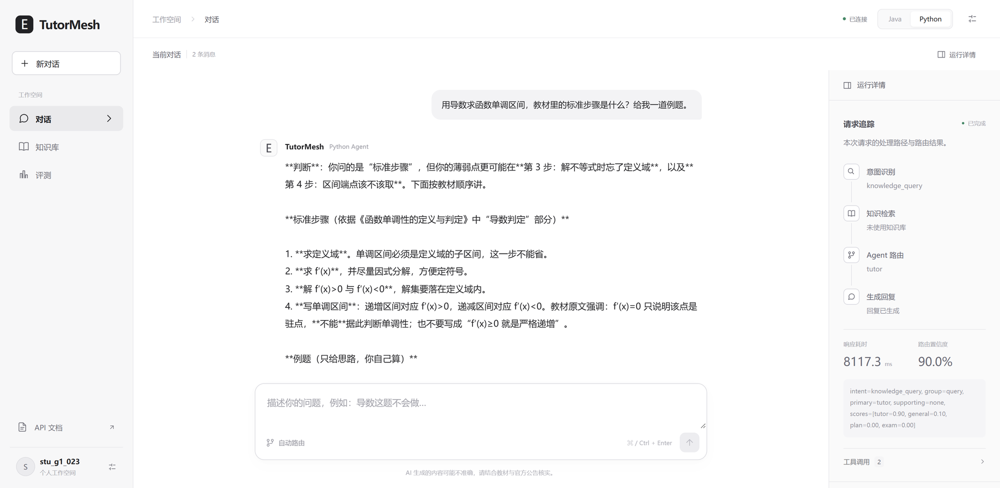
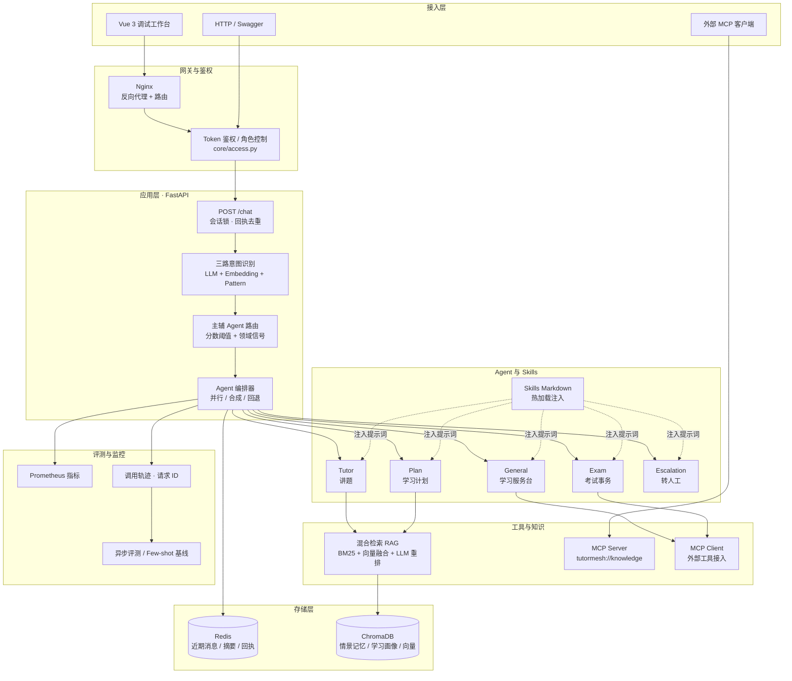

# TutorMesh · 面向在线教育场景的多 Agent 学习辅导系统

<p align="left">
  
  
  
  
  
  
  
  
</p>

TutorMesh 是一个**可跑、可评测、可观测**的学习辅导 Agent 系统。它把「三路意图识别 → 主辅 Agent 路由 → 结构化 RAG 检索 → 分层记忆/学习画像 → 动态 Skills 注入 → 异步评测与在线监控」串成一条完整的对话链路，用来回答一个工程问题：**多 Agent 到底该怎么拆、拆完怎么让它不失控。**

它不是把 ChatGPT 套个网页壳：路由是可解释的加权融合、检索带元数据过滤、记忆分短期/情景/画像三层、每个 Agent 的提示词来自可热加载的 Markdown 规范、故障有熔断降权、质量有回归基线。

<p align="center">
  
</p>

<p align="center">
  <sub>Vue 3 调试工作台实拍：左侧是真实对话（高一导数求单调区间），右侧是这次请求的运行轨迹——意图 knowledge_query、主 Agent 为 tutor、响应 8.1s、路由置信度 90%、工具调用 2 次</sub>
</p>

---

## 核心能力

| 能力 | 实现方式 |
|---|---|
| **三路意图识别** | LLM + Embedding 向量 + Pattern 规则加权融合（默认 0.7 / 0.2 / 0.1），输出意图 + 学科/章节/年级实体；单路失败自动降级，不阻塞对话 |
| **主辅 Agent 路由** | General（学习服务台）/ Tutor（讲题）/ Plan（计划）/ Exam（考试）/ Escalation（转人工）五个角色；复合诉求并行执行主辅 Agent 再合成回复 |
| **混合检索 RAG** | 知识库按 `学科/章节/难度/年级/文档类型` 打标签；BM25 关键词召回与向量召回分数归一化后加权融合（0.45/0.55），再做查询改写与 LLM 重排。自建 57 条评测集（43 篇语料含 29 篇同类干扰文档）实测 Recall@1 由 15.8% 提升至 40.4%、MRR 0.19 → 0.63 |
| **分层记忆与学习画像** | Redis 存近期消息 + 滚动摘要；ChromaDB 存情景记忆与画像（年级、薄弱章节、目标、可投入时间），讲解与排计划时作为上下文注入 |
| **动态 Skills** | 业务规范写在 Markdown 里，按 Agent + 关键词匹配后注入提示词，支持运行时热重载，改规则不用改代码 |
| **标准 MCP** | 基于官方 SDK 接入外部 MCP 工具，同时把本地知识库以 MCP 资源（`tutormesh://knowledge/stats`）暴露给其他客户端 |
| **稳定性工程** | 会话并发锁、重复请求回执、工具超时/缓存/熔断、专业 Agent 故障回退、请求 ID 全链路轨迹 |
| **评测与监控** | 异步评测任务（意图准确率、对话质量、Few-shot 回归基线）+ Prometheus 指标 + 路由降权/冷却恢复机制 |
| **可观测的 Web 控制台** | Vue 3 调试工作台：对话、知识库导入检索、评测任务、调用轨迹、后端切换 |

## 整体架构



## 一条消息的完整链路

```text
用户消息
  → 鉴权 + 会话锁 + 重复请求回执检查
  → 读取近期消息 / 摘要 / 相关情景记忆 / 学习画像
  → 三路意图识别（LLM + Embedding + Pattern 加权融合）
  → 路由决策
      ├─ 需要澄清 → 澄清追问
      ├─ 单 Agent  → 讲题 / 计划 / 考试，失败回退 General
      └─ 复合诉求  → 主辅 Agent 并行执行 → ResponseComposer 合成
  → Agent 执行期间按需调用：共享 RAG / 角色工具 / 外部 MCP 工具
  → 记录路由结果与工具轨迹（可按请求 ID 回查）
  → Redis 事务写入用户消息、助手回复、响应回执
  → 后台异步：记忆压缩、画像更新、指标上报
```

## 仓库结构

```text
TutorMesh/
├── TutorMesh/                    # Python 后端（FastAPI · 主实现）
│   ├── api/main.py             # HTTP 入口、鉴权、CLI
│   ├── core/                   # 意图识别、并发、会话状态、Skills 加载、监控
│   ├── agents/                 # Agent 编排器与工具集
│   ├── tooling/                # RAG 知识库、MCP 客户端/服务端
│   ├── memory/                 # 分层记忆与压缩
│   ├── evaluation/             # 异步评测、Few-shot 回归
│   ├── skills/                 # 四个业务角色的 Markdown 规范（可热加载）
│   ├── config/                 # Nginx / Prometheus 配置
│   ├── tests/                  # 单测与回归用例
│   ├── wiki/                   # 架构图、12 篇教程、业务流程与技术亮点文档
│   └── docker-compose.yml      # 一键拉起 API + Redis + ChromaDB + Prometheus + Nginx
└── TutorMeshFrontend/            # Vue 3 + Vite 调试工作台
    ├── src/                    # 对话、知识库、评测、轨迹等视图
    └── docker/                 # 网关配置与容器入口
```

## 快速开始

### 方式一：Docker Compose（推荐）

```bash
cd TutorMesh
cp .env.example .env          # 填入 ANTHROPIC_API_KEY / ANTHROPIC_BASE_URL
docker compose up -d --build
```

启动后：

| 服务 | 地址 |
|---|---|
| OpenAPI 文档 | http://localhost:8000/docs |
| 健康检查 | http://localhost:8000/health |
| Prometheus 指标 | http://localhost:8000/metrics |

### 方式二：连同 Web 前端一起跑

```bash
cd TutorMesh
docker compose -f docker-compose.yml -f docker-compose.web.yml up -d --build
```

调试工作台：http://localhost:5174

### 方式三：本地开发

```bash
cd TutorMesh
python -m venv .venv && source .venv/bin/activate
pip install -r requirements.txt -r requirements-dev.txt
cp .env.example .env
uvicorn api.main:app --reload
```

## 文档索引

面向不同读者的入口都在 [`TutorMesh/wiki/`](TutorMesh/wiki/)：

| 想了解什么 | 看这篇 |
|---|---|
| 项目定位、技术亮点 | [教育培训场景定位与技术亮点.md](TutorMesh/wiki/教育培训场景定位与技术亮点.md) |
| 完整使用指南（配置、接口、数据字典） | [教育培训完整使用指南.md](TutorMesh/wiki/教育培训完整使用指南.md) |
| 架构图与流程图 | [教育培训架构图.md](TutorMesh/wiki/教育培训架构图.md) · [assets/architecture](TutorMesh/wiki/assets/architecture) |
| 从零读懂代码（12 篇系列教程） | [wiki/教程/](TutorMesh/wiki/教程/) |
| 业务流程与角色边界 | [教育培训业务流程说明.md](TutorMesh/wiki/教育培训业务流程说明.md) |
| 二次开发 / 换业务场景 | [教育培训场景扩展与改造指南.md](TutorMesh/wiki/教育培训场景扩展与改造指南.md) |
| 场景改造全过程（文件级改动 + 设计取舍） | [教育培训场景改造说明.md](TutorMesh/wiki/教育培训场景改造说明.md) |
| 接口与数据字典 | [教育培训教程-附录-接口配置与数据字典.md](TutorMesh/wiki/教程/教育培训教程-附录-接口配置与数据字典.md) |
| 后端完整说明 | [TutorMesh/README.md](TutorMesh/README.md) |

## 技术栈

**后端**：FastAPI 0.115 · Uvicorn · Pydantic 2 · Anthropic SDK · ChromaDB 0.5 · Redis 7 · MCP 1.26 · Prometheus Client
**前端**：Vue 3.5 · Vite 7 · 原生 ESM 组件
**部署**：Docker Compose · Nginx · Prometheus

## 检索评测

原始知识库只有 14 篇教材，Top-5 直接覆盖三分之一语料，任何策略都会"满分"。为了测出真实差距，
补充了 29 篇**同学科同章节的干扰文档**（"函数单调性"与"函数奇偶性""数列单调性"混在一起），
语料扩到 43 篇后自建 57 条标注查询（术语型 37 / 口语型 20，其中 16 条标注多个正确文档）：

| 配置 | Recall@1 | Recall@3 | Recall@5 | MRR@10 | NDCG@10 |
| --- | ---: | ---: | ---: | ---: | ---: |
| 纯向量（ChromaDB 默认 embedding） | 15.79% | 24.56% | 28.07% | 0.1942 | 0.1856 |
| + BM25 加权融合（0.45 / 0.55） | **40.35%** | **82.46%** | **96.49%** | **0.6310** | **0.6641** |

结论与取舍：

- **BM25 是这个项目当前召回的主力**。ChromaDB 默认 embedding 是英文模型 `all-MiniLM-L6-v2`，
  对中文区分度有限，纯向量基线只有 15.8% 的 Recall@1；接入 BM25 后升到 40.4%，两路耗时都在 50 ms 内。
- **看 Recall@1 和 MRR，不要只看 Recall@5**。术语型查询（直接说"单调性""非谓语"）融合后 Recall@5 触顶，
  真正拉开差距的是首位命中率——这也是线上每次只注入 Top-3 时最该看的指标。
- **重排档不作为效果声明**：改写 + LLM 重排在 43 篇语料上 57/57 全部首位命中，指标饱和、
  没有区分度（重排只需在 10 个候选里挑一个），且成本约 2 秒/条，所以默认链路不开重排。
- 这组数字只适合**同数据集横向对比**，语料仅 43 篇，不能外推到业务规模。

复跑方式、分风格指标与偏差说明见 [`evaluation/results/retrieval_eval.md`](evaluation/results/retrieval_eval.md)。

## 设计取舍

- **意图识别只负责路由和上下文，RAG 由 Agent 主动调用工具** —— 避免把检索写死在管道里，Agent 才能自己决定"要不要查、查什么"。
- **讲题与作业辅导共用一套教材知识库**，靠元数据（学科/章节/难度）区分，而不是按意图各维护一份语料。
- **融合分数不是准确率**。意图权重与阈值（LLM 0.7 / Embedding 0.2 / Pattern 0.1，低置信阈值 0.5）需要在业务标注集上验证后调整，代码里不把它们当"正确答案"。
- **业务规则外置成 Markdown Skills**，运营改话术不用发版，Agent 只加载匹配当前请求的那几条，控制 prompt 体积。

## 说明

本仓库为学习与工程实践项目：演示数据为教材知识点语料，模型输出可能存在偏差。涉及成绩查询、报名缴费、排课改期的真实业务需要接入教育平台系统；讲题只给思路与关键步骤、不代写作业，计划不承诺提分。

---

如果这个项目对你有帮助，欢迎 Star ⭐
